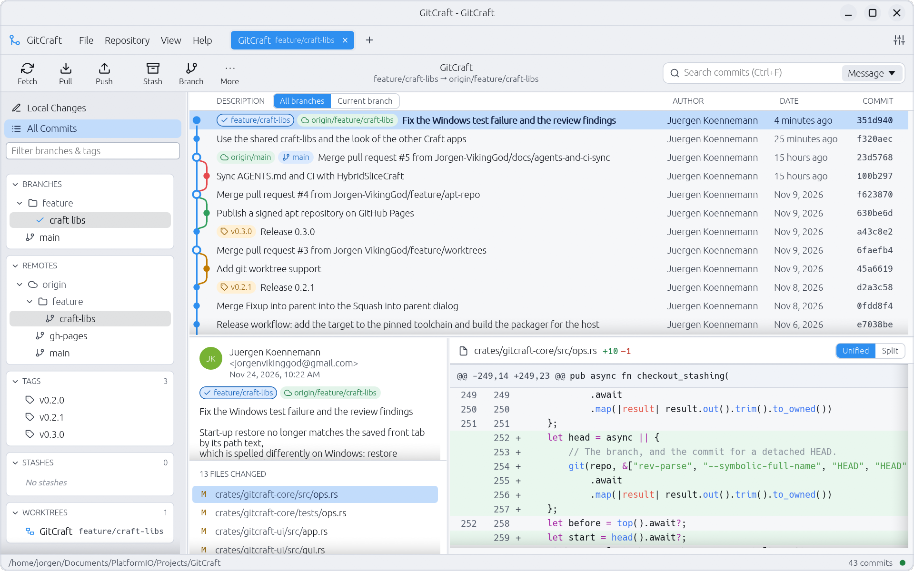
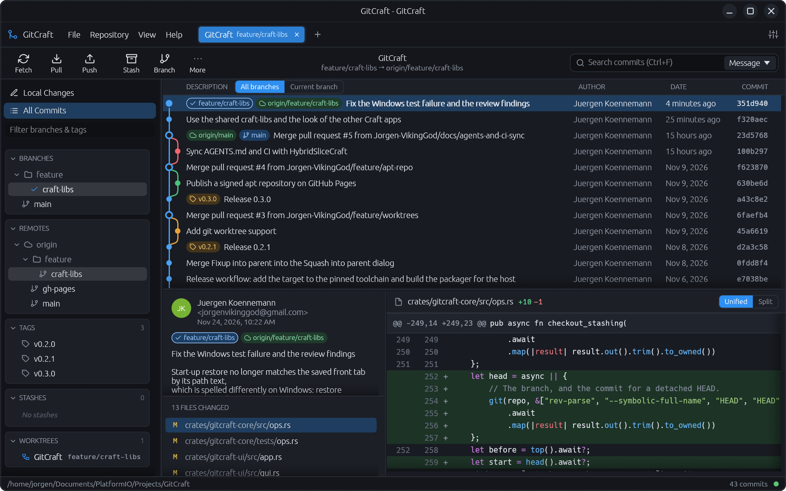

# GitCraft

An open-source, cross-platform graphical Git client for Linux, macOS and Windows.
GitCraft is a single native program written in Rust, with an [egui](https://www.egui.rs/) UI. It drives your
installed `git`, so it behaves the same as git on the command line and uses your existing git setup.

| Light | Dark |
| --- | --- |
|  |  |

## Features

- **Commit graph**: virtual-scrolled history of all branches with lane graph, branch/tag/remote badges,
  commit details (with the signature's state for signed commits) and per-file diffs (unified or
  side-by-side, syntax highlighted; long lines scroll sideways, and each side of a side-by-side diff
  has its own scroll bar).
- **Local changes**: stage/unstage/discard files, **hunks or individual lines**; commit, amend,
  commit templates; multi-select with Ctrl/Shift. Commit options: sign-off, skip hooks, co-authors
  (`Co-authored-by`) and push after committing; amending a commit that is already pushed asks first.
- **Branches, tags, remotes**: sidebar with folder trees, ahead/behind counts, checkout (double-click),
  create, rename, delete, upstream tracking, push/delete remote branches and tags, add/edit/remove remotes.
- **Fetch / pull / push** with live progress (merge, rebase or fast-forward pulls; force-with-lease).
- **Conflict check**: the merge and rebase dialogs say beforehand which files would conflict (git 2.38+).
- **Merge, rebase (with optional autostash), cherry-pick, revert, reset (soft/mixed/keep/hard), undo last
  commit** from context menus on commits, branch/tag badges and sidebar refs; banner with
  Continue/Skip/Abort while an operation is in progress.
- **Edit history** from the commit menu: edit message, squash/fixup into parent, drop commit, make a
  `fixup!` commit of the staged changes for any commit of the branch. In a
  commit's diff, **Revert hunk** (or selected lines) takes just that part back out of the working tree.
- **Undo and redo** (*Edit* menu, Ctrl/⌘ + Z) for commits, amends, resets, checkouts, branches, tags,
  merges, rebases, cherry-picks, reverts, pulls and discards. Discarded changes are also kept for 30
  days under *Repository › Recover discarded changes*.
- **Bisect**: start from a broken commit's menu, name one that still worked, then mark each commit
  GitCraft checks out as good, bad or skip in the bisect bar until the first bad commit is found.
- **Several commits at once**: pick them with Ctrl/Cmd+click or Shift+click, then cherry-pick them,
  squash or drop them (the interactive rebase editor opens with the plan), or replay them onto HEAD
  in the editor (interactive cherry-pick).
- **Compare** any two commits (Ctrl/Cmd+click), or a commit with the working directory, or two versions
  of a series of commits (*Repository › Compare commit ranges*, `git range-diff`), filter history to the current branch, **reflog** to
  recover lost commits, fast-forward branches without checking them out.
- **Patches** (save a commit, the commits from one up to HEAD, or the local changes as a patch;
  apply / `git am`), **.gitignore** from the changes list, stash selected
  files, clean untracked files, checkout a file at a revision, prune remotes, update submodules.
- **Interactive rebase** editor: drag to reorder, pick/reword/edit/squash/fixup/drop, keyboard shortcuts,
  **Autosquash** for `fixup!`/`squash!` commits, and a command to run after any commit (`exec`, e.g. the
  tests). A plan is refused once the branch has moved since it was made. Commits can also be moved up
  or down one place from the commit menu.
- **Conflict resolver**: per-conflict ours/theirs/both choices, editable result, take whole file.
- **External diff and merge tools**: GitCraft finds the ones git can start (KDiff3, Beyond Compare,
  Meld, P4Merge, WinMerge, VS Code… and any set up as `difftool.<name>.cmd`). Choose them in Settings,
  then open a file's change or a conflict in them from its right-click menu.
- **Checkout with local changes** asks first: stash and reapply, commit first, or put them aside in a stash.
- **Stashes**: create (incl. untracked, staged only, only the untracked files, or just a hunk or some
  lines of a file), browse, rename, take a single file back,
  apply, pop, drop.
- **Worktrees**: listed in the sidebar with their branch; add, open in a new tab, remove, prune. Tabs and the window title show when a repository is a linked worktree.
- **File history**, **blame**, **commit search** (message, author, SHA, content `-S`).
- **Stashes in the history**, each right above the commit it was made on (click to open it), and an
  optional date order for the graph (Settings › Repository).
- **Hide or solo branches** in the graph from a branch's menu, remembered for each repository.
- **Filter the history** (*View › Filter history…*) by author, file or folder, or changed text (`-S`,
  or a regular expression with `-G`); a file's menu shows the history of its folder.
- Repository **tabs**, recent repositories, clone, init.
- Live refresh through file watching, **light/dark** theme that follows the system, zoom, keyboard
  shortcuts, and a menu bar with the shortcuts beside each command.
- **Languages**: English, German, French and Spanish (*View › Language*, or the system's language).
- On most desktops GitCraft draws its own title bar, with the window buttons in the desktop's look and
  order (GNOME, KDE, Windows); on macOS the traffic lights sit in it, and tiling window managers keep
  their own frame. *View › Use system title bar* gives the frame to the system (after a restart), as do
  `GITCRAFT_TITLEBAR=system` and the older `GITCRAFT_SYSTEM_FRAME=1`. The window opens with the size and
  place it had last time.

### Pull and rebase options

**Pull** (toolbar, or *Pull…* in the context menu of the current branch) asks for the remote, the remote branch and a strategy:

| Strategy | git command | Result |
| --- | --- | --- |
| Merge | `git pull --no-rebase` | Creates a merge commit if both sides have new commits |
| Rebase | `git pull --rebase` | Replays your local commits on top of the remote branch (linear history) |
| Fast-forward only | `git pull --ff-only` | Only updates if no merge or rebase is needed; otherwise stops |
| Overwrite local branch | `git fetch`, then `git reset --hard <remote>/<branch>` | Makes the current branch equal to the remote branch; local commits and uncommitted changes are discarded |

**Overwrite local branch** asks for confirmation first. With **Overwrite only: keep a backup branch of the
current state** (on by default) the old tip is kept as `backup/<branch>-<short sha>` before the reset, so
committed work can be recovered; uncommitted changes are not covered by the backup. Overwrite is never
remembered as the usual strategy.

**Rebase** (context menu of a local or remote branch: *Rebase &lt;current&gt; onto …*) replays the current
branch on top of the chosen one (`git rebase <target>`).

Both dialogs have **Stash and reapply local changes** (`--autostash`): uncommitted changes are stashed
before the operation and restored afterwards, so you can pull or rebase without committing first.
Without it, a rebase refuses to start while tracked files have uncommitted changes (a merge
pull only when they are in the way). If the restored changes conflict,
they stay in the stash list. GitCraft remembers the strategy and the autostash choice for the next
time. Conflicts during a pull or rebase are shown in the operation banner with Continue / Skip / Abort
and can be resolved in the built-in conflict resolver.

### Keyboard shortcuts

| Keys | Action |
| --- | --- |
| Ctrl/⌘ + 1 / 2 | All commits / Local changes |
| Ctrl/⌘ + F | Search commits |
| Ctrl/⌘ + Z, Ctrl/⌘ + Shift + Z or Y | Undo / redo the last operation (outside text fields) |
| Ctrl/⌘ + A | Select every file of the list in Local changes |
| Ctrl/⌘ + T or O | Open repository |
| Ctrl/⌘ + W | Close tab |
| Ctrl/⌘ + Enter | Commit |
| Ctrl/⌘ + Shift + Enter | Stage everything and commit |
| Ctrl/⌘ + + / − / 0 | Zoom |
| F5 or Ctrl/⌘ + R | Refresh repository |
| F11 | Full screen |
| ↑ ↓ PgUp PgDn | Move through commits, or through the files of the list you clicked last |

In the interactive rebase editor, ↑ ↓ moves the focus, Alt + ↑ ↓ moves the commit, and
<kbd>p</kbd> <kbd>r</kbd> <kbd>e</kbd> <kbd>s</kbd> <kbd>f</kbd> <kbd>d</kbd> set its action.

## Requirements

To run GitCraft you need `git` 2.35 or newer. GitCraft finds it on `PATH`, including the `PATH` of your
login shell when it is started from a desktop launcher.

To build it you also need [rustup](https://rustup.rs/). `rust-toolchain.toml` pins the Rust version,
and rustup installs that version by itself.

## Build & run

```bash
cargo run --release -p gitcraft-ui                  # start GitCraft
cargo run --release -p gitcraft-ui -- path/to/repo  # start GitCraft and open a repository
```

The program takes one optional argument, the repository to open, and is called `gitcraft`
(`target/release/gitcraft`). A second launch hands its repository to the window that is already open
and exits.

Settings and open tabs (`config.toml`), recent repositories (`repos.json`) and the window's size and
place (`window.json`) are stored in the user config folder: `~/.config/gitcraft` on Linux,
`~/Library/Application Support/gitcraft` on macOS and `%LOCALAPPDATA%\gitcraft` on Windows. Set
`GITCRAFT_CONFIG_DIR` to use a different folder. A `settings.json` from GitCraft 0.3 or older is read
once, when there is no `config.toml` yet.

Authentication for remotes uses your normal git setup: credential helpers (e.g. Git Credential Manager,
macOS keychain, libsecret) and the SSH agent. GitCraft never prompts for passwords itself.

## Installers

Installers are built with [cargo-packager](https://github.com/crabnebula-dev/cargo-packager), which
also builds the release binary:

```bash
cargo install cargo-packager --locked --version 0.11.8
cd crates/gitcraft-ui
cargo packager --release --formats deb,appimage     # output goes to target/packages/
```

| Platform | `--formats` | Output |
| --- | --- | --- |
| Linux | `deb,appimage` | `.deb`, `.AppImage` |
| macOS | `dmg` | `.dmg` |
| Windows | `wix` | `.msi` installer |

On Debian and Ubuntu (64-bit) you can install from the apt repository, which also delivers updates:

```bash
sudo install -d -m 0755 /etc/apt/keyrings
curl -fsSL https://jorgen-vikinggod.github.io/GitCraft/gitcraft.gpg | sudo tee /etc/apt/keyrings/gitcraft.gpg >/dev/null
echo "deb [signed-by=/etc/apt/keyrings/gitcraft.gpg] https://jorgen-vikinggod.github.io/GitCraft stable main" | sudo tee /etc/apt/sources.list.d/gitcraft.list
sudo apt update && sudo apt install git-craft
```

The package is called `git-craft`; the program it installs is started as `gitcraft`.

Installers must be built on their own OS. `.github/workflows/release.yml` builds all of them when a
release is published and attaches them to it (it can also be started by hand from the Actions tab).
The builds are unsigned, apart from the ad-hoc signature that
Apple Silicon requires, so add code-signing for public releases. `git` must be installed on the user's
machine (the `.deb` depends on it).

## Development

```bash
cargo run -p gitcraft-ui -- path/to/repo            # debug build
cargo test --workspace                              # real git against throwaway repositories, no mocks
cargo fmt --all --check
cargo clippy --workspace --all-targets -- -D warnings
```

`.github/workflows/rust.yml` runs the tests on Linux, macOS and Windows.

## Architecture

```
gitcraft-ui (egui) ──function calls──►  gitcraft-core  ──►  git CLI (async subprocess, no shell)
```

| Path | Purpose |
| --- | --- |
| `crates/gitcraft-core/src/runner.rs` | Runs `git` without a shell or terminal; non-interactive editor; per-repo lock |
| `crates/gitcraft-core/src/parsers.rs` | Parsers for log, status v2, refs, diffs, blame, conflict markers; partial patch builder |
| `crates/gitcraft-core/src/graph.rs` | Lane layout for the commit graph |
| `crates/gitcraft-core/src/queries.rs` / `ops.rs` | Read-only queries / mutating operations |
| `crates/gitcraft-core/src/editor.rs` | `GIT_EDITOR` / `GIT_SEQUENCE_EDITOR` mode of the program, used for interactive rebase |
| `crates/gitcraft-core/src/watcher.rs` | File-system change notifications |
| `crates/gitcraft-ui/src/app.rs` | Application state, messages and the update loop |
| `crates/gitcraft-ui/src/command.rs` / `actions.rs` | Git operations as data / dialogs and context menus |
| `crates/gitcraft-ui/src/views/` | Everything drawn on screen: history, changes, diff, sidebar, overlays |

Line staging works by rebuilding a patch with only the selected lines from the parsed diff and applying
it with `git apply --cached [--reverse] --recount`.

### Security

GitCraft talks to git directly and has no web server or API. It opens a single port on `127.0.0.1`, so
that a second launch can pass a repository path to the running window. That port accepts nothing else.
Passwords in remote URLs are masked in what GitCraft shows.

## Author

Jürgen Könnemann

## License

MIT © 2026 Jürgen Könnemann
