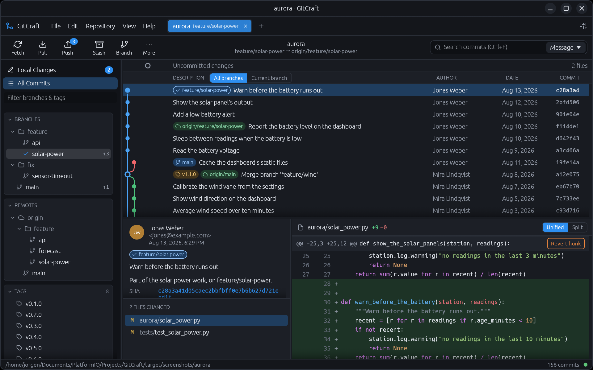
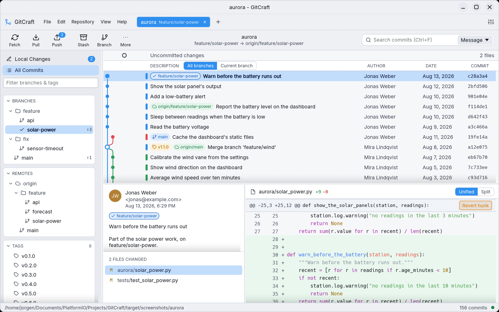
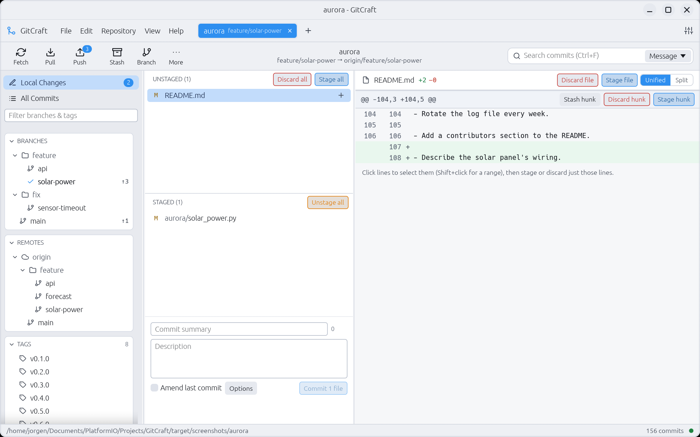
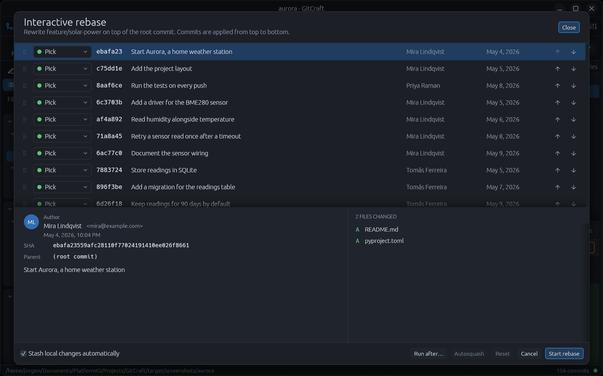
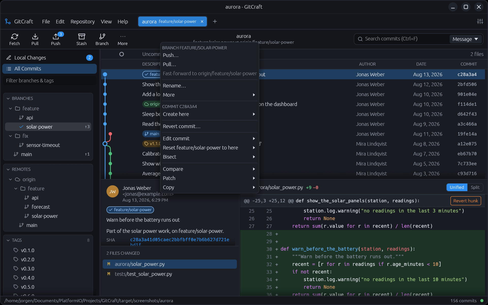
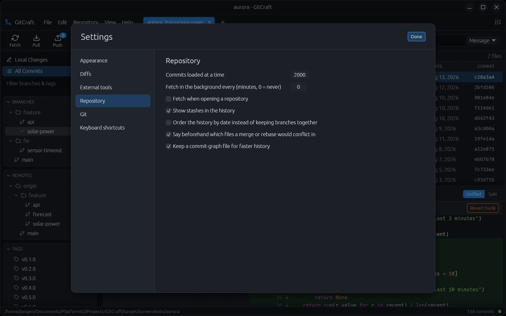

<h1 align="center">GitCraft</h1>

<p align="center">
An open-source graphical Git client for Linux, macOS and Windows.<br>
One native program written in Rust, driving the <code>git</code> you already have installed.
</p>

<p align="center">
<a href="https://github.com/Jorgen-VikingGod/GitCraft/actions/workflows/rust.yml"></a>
<a href="https://github.com/Jorgen-VikingGod/GitCraft/releases/latest"></a>


<a href="LICENSE"></a>
</p>

<p align="center">
<a href="#features">Features</a> ·
<a href="#download">Download</a> ·
<a href="#getting-started">Getting started</a> ·
<a href="#guide">Guide</a> ·
<a href="#development">Development</a> ·
<a href="#contributing">Contributing</a> ·
<a href="#license">License</a>
</p>

<p align="center">

</p>

<table align="center">
<tr>
<td align="center"><br>Light mode</td>
<td align="center"><br>Staging hunks and lines</td>
<td align="center"><br>Interactive rebase</td>
</tr>
<tr>
<td align="center"><br>Branch and commit menus</td>
<td align="center"><br>Settings</td>
<td></td>
</tr>
</table>

<p align="center">
GitCraft is one of the Craft apps: it is built on <a href="https://github.com/storytold/craft-libs">craft-libs</a>,
the shared libraries of the ArtCraft community, so its window, menus and keys work like those of the other
Craft apps.
</p>

## Features

| | |
|---|---|
| **History**<br>commit graph of all branches with lanes and labels, filters, search, blame and file history | **Staging**<br>stage, unstage, discard or stash whole files, single hunks or selected lines |
| **Rewriting history**<br>interactive rebase, squash, fixup, reword, cherry-pick, revert, reset, bisect | **Undo and redo**<br>for commits, resets, checkouts, branches, merges, rebases, pulls and discards |
| **Branches and remotes**<br>fetch, pull, push with progress, upstreams, worktrees, cleanup of merged branches | **Repository tools**<br>stashes, submodules, sparse checkout, Git LFS, patches, maintenance |
| **Safe by default**<br>discarded changes are kept for 30 days, force pushes use a lease, nothing prompts | **At home on every desktop**<br>light and dark theme, its own title bar, four languages, keyboard shortcuts |

<details>
<summary><b>History and the commit graph</b></summary>

- **Commit graph** of all branches (or only the current one), virtual-scrolled, with lanes and labels for
  branches, tags and remotes.
- **Commit details** with the signature's state for signed commits, and **diffs** per file: unified or
  side by side, syntax highlighted; long lines scroll sideways, and each side of a side-by-side diff has
  its own scroll bar.
- **Columns**: right-click the column header to choose author, date, commit and a Changes column (lines
  added and removed); drag the date and author columns' left edge to resize them.
- **Hide or solo branches** with the eye and filter icons on a branch's row in the sidebar, or from its
  menu; remembered for each repository. A hidden branch's label goes too.
- **Filter the history** (*View › Filter history…*) by author, file or folder, or changed text (`-S`, or a
  regular expression with `-G`); a file's menu shows the history of its folder.
- **Search** commits by message, author, SHA or content (`-S`).
- **Stashes in the history**, each right above the commit it was made on, and an optional date order
  (Settings › Repository).
- **Compare** any two commits (Ctrl/⌘+click), a commit with the working directory, or two versions of a
  series of commits (*Repository › Compare commit ranges*, `git range-diff`).
- **File history**, **blame** (optionally skipping the commits in `.git-blame-ignore-revs`) and the
  **reflog** of HEAD or of every branch, to find lost commits.

</details>

<details>
<summary><b>Local changes and committing</b></summary>

- **Stage, unstage and discard** files, **hunks or single lines**; select several files with Ctrl/Shift.
- **Commit and amend**, with commit templates. Options: sign-off, skip hooks, co-authors
  (`Co-authored-by`) and push after committing; amending a commit that is already pushed asks first.
- **Stashes**: create (including untracked files, only the staged changes, only the untracked files, or
  just a hunk or some lines), browse, rename, apply, pop, drop, or take a single file back.
- **Discarded changes are kept** for 30 days (*Repository › Recover discarded changes*), and can be put
  back without overwriting what changed since.
- **Patches**: save a commit, the commits from one up to HEAD, or the local changes as a patch; apply a
  patch or a mailbox (`git am`).
- **.gitignore** from the changes list, clean untracked files (with a preview), check out a file as it was
  in any commit, copy a file's text from a commit, mark a resolved file as conflicted again.

</details>

<details>
<summary><b>Branches, tags and remotes</b></summary>

- **Sidebar** with folder trees, ahead/behind counts, checkout by double-click, create, rename, delete,
  upstream tracking.
- **Fetch, pull and push** with live progress: merge, rebase or fast-forward pulls, force with lease. When
  a push or pull fails, GitCraft offers the way out (set the upstream, add a remote, push with lease).
- **Background fetch** every few minutes (Settings › Repository; off by default), quiet and never
  prompting.
- **Remotes**: add, edit (with a separate push URL), remove, prune; delete tags on one chosen remote;
  forget the saved passwords of a repository's remotes.
- **Checkout with local changes** asks first: stash and reapply, bring them along, commit first, or put
  them aside. Checking out a remote branch fast-forwards its local branch when that is behind.
- **Clean up branches** (*Repository › Clean up branches…*): merged, squash- or rebase-merged, and those
  whose upstream is gone, reviewed in a list; optionally their remote branches too; undoable.
- **Shallow and partial clones** can fetch more history or what they left out.

</details>

<details>
<summary><b>Rewriting history</b></summary>

- **Merge, rebase (with optional autostash), cherry-pick, revert and reset** (soft, mixed, keep, hard)
  from the menus of commits, branches and tags. A banner with Continue / Skip / Abort shows while an
  operation is in progress, and a built-in **conflict resolver** picks ours, theirs or both per conflict.
- **Conflict check**: the merge and rebase dialogs say beforehand which files would conflict (git 2.38+).
- **Interactive rebase editor**: each commit's action from a dropdown (pick, reword, edit, squash, fixup,
  drop) or its key, drag or the arrows to reorder, the highlighted commit's author, message and files
  below the list, **Autosquash** for `fixup!` and `squash!` commits, and a command to run after any commit
  (`exec`, such as the tests). A plan is refused once the branch has moved since it was made.
- **Edit a commit** from its menu: reword, squash into its parent, drop, move it up or down, or make a
  `fixup!` commit of the staged changes for it. **Revert a hunk** (or some lines) of any commit.
- **Several commits at once**: pick them with Ctrl/⌘+click or Shift+click, then cherry-pick, squash, drop
  or replay them onto HEAD.
- **Bisect**: start from a broken commit's menu, name one that still worked, then mark each commit as
  good, bad or skip until the first bad one is found.
- **Undo and redo** (*Edit* menu, Ctrl/⌘+Z) for commits, amends, resets, checkouts, branches, tags,
  merges, rebases, cherry-picks, reverts, pulls and discards.

</details>

<details>
<summary><b>Repositories, worktrees, submodules and LFS</b></summary>

- **Tabs** for several repositories, recent repositories, and `gitcraft://clone?url=` links.
- **Clone** with options: one branch, only the newest commits or those since a date, without submodules,
  blobless, or only some folders (sparse). **Init** with a first branch name, a `.gitignore` for a
  language, a README and a first commit.
- **Worktrees** in the sidebar with their branch: add (also from a commit or branch menu), open in a new
  tab, lock with a reason, unlock, remove, prune.
- **Submodules**: add, update one or all, remove.
- **Sparse checkout** (*Repository › Sparse checkout…*): check out only some folders or patterns.
- **Git LFS** (*Repository › Git LFS*, when git-lfs is installed): set it up, store files by pattern
  (optionally lockable), download the LFS files, and lock or unlock files, with a list of every lock on
  the server. A checkout that needs LFS is refused while git-lfs is missing, instead of leaving
  placeholder files.
- **Maintenance** (*Repository › Maintenance…*): gc, the commit-graph, and fetch with prune.

</details>

<details>
<summary><b>Settings and the window</b></summary>

- **Settings** with a page per topic: appearance, diffs, external tools, repository and git.
- **Git's own settings** (*Settings › Git*), everywhere or for one repository: name and email, commit and
  tag signing (GPG, SSH or X.509, key, allowed signers), line endings, first branch name, rerere, hooks
  folder, and which git program GitCraft runs.
- **External diff and merge tools**: GitCraft finds the ones git can start (KDiff3, Beyond Compare, Meld,
  P4Merge, WinMerge, VS Code… and any set up as `difftool.<name>.cmd`) and opens a file's change or a
  conflict in them from its menu.
- **Light and dark** theme that follows the system, zoom, keyboard shortcuts, and a menu bar with the
  shortcut beside each command.
- **Languages**: English, German, French and Spanish (*View › Language*, or the system's language).
- **Its own title bar** on most desktops, with the window buttons in the desktop's look and order (GNOME,
  KDE, Windows); on macOS the traffic lights sit in it, and tiling window managers keep their own frame.
  *View › Use system title bar* gives the frame to the system. The window opens with the size and place it
  had last time.
- **Live refresh** through file watching.

</details>

## Download

Installers for every platform are attached to each
[release](https://github.com/Jorgen-VikingGod/GitCraft/releases/latest):

| Platform | Download |
| --- | --- |
| Linux | `.deb` and `.AppImage` |
| macOS | `.dmg`, for Apple silicon and for Intel |
| Windows | `.msi` installer |

On Debian and Ubuntu (64-bit) you can install from the apt repository, which also delivers updates:

```bash
sudo install -d -m 0755 /etc/apt/keyrings
curl -fsSL https://jorgen-vikinggod.github.io/GitCraft/gitcraft.gpg | sudo tee /etc/apt/keyrings/gitcraft.gpg >/dev/null
echo "deb [signed-by=/etc/apt/keyrings/gitcraft.gpg] https://jorgen-vikinggod.github.io/GitCraft stable main" | sudo tee /etc/apt/sources.list.d/gitcraft.list
sudo apt update && sudo apt install git-craft
```

The package is called `git-craft`; the program it installs is started as `gitcraft`. The installers aren't
code-signed yet (apart from the ad-hoc signature Apple silicon requires), so macOS and Windows may ask you
to confirm the first start.

## Getting started

GitCraft needs **git 2.35 or newer**. It finds git on `PATH`, including the `PATH` of your login shell when
it is started from a desktop launcher; *Settings › Git* can point it at another git program.

```bash
gitcraft                 # start GitCraft
gitcraft path/to/repo    # start GitCraft and open a repository
```

A second start hands its repository to the window that is already open, and exits.

**Signing in to remotes** uses your normal git setup: credential helpers (Git Credential Manager, the macOS
keychain, libsecret…) and the SSH agent. GitCraft never asks for passwords itself.

**Settings** and open tabs (`config.toml`), recent repositories (`repos.json`) and the window's size and
place (`window.json`) are kept in the user config folder: `~/.config/gitcraft` on Linux,
`~/Library/Application Support/gitcraft` on macOS and `%LOCALAPPDATA%\gitcraft` on Windows. Set
`GITCRAFT_CONFIG_DIR` to use another folder. *Help › Show data folder* opens it, and *Help › About
GitCraft* shows the version and the git in use.

## Guide

<details>
<summary><b>Pull and rebase options</b></summary>

**Pull** (toolbar, or *Pull…* in the menu of the current branch) asks for the remote, the remote branch and
a strategy:

| Strategy | git command | Result |
| --- | --- | --- |
| Merge | `git pull --no-rebase` | Creates a merge commit if both sides have new commits |
| Rebase | `git pull --rebase` | Replays your local commits on top of the remote branch (linear history) |
| Fast-forward only | `git pull --ff-only` | Only updates if no merge or rebase is needed; otherwise stops |
| Overwrite local branch | `git fetch`, then `git reset --hard <remote>/<branch>` | Makes the current branch equal to the remote branch; local commits and uncommitted changes are discarded |

**Overwrite local branch** asks for confirmation first. With **Overwrite only: keep a backup branch of the
current state** (on by default) the old tip is kept as `backup/<branch>-<short sha>` before the reset, so
committed work can be recovered; uncommitted changes are not covered by the backup. Overwrite is never
remembered as the usual strategy.

**Rebase** (menu of a local or remote branch: *Rebase &lt;current&gt; onto …*) replays the current branch on
top of the chosen one (`git rebase <target>`).

Both dialogs have **Stash and reapply local changes** (`--autostash`): uncommitted changes are stashed before
the operation and restored afterwards, so you can pull or rebase without committing first. Without it, a
rebase refuses to start while tracked files have uncommitted changes (a merge pull only when they are in
the way). If the restored changes conflict, they stay in the stash list. GitCraft remembers the strategy
and the autostash choice for the next time. Conflicts during a pull or rebase are shown in the operation
banner with Continue / Skip / Abort and can be resolved in the built-in conflict resolver.

</details>

<details>
<summary><b>Keyboard shortcuts</b></summary>

These are the defaults. *Settings › Keyboard shortcuts* changes them: click a key and press the new
one, add a second key with +, go back to the default or clear a command's keys. Your keys are saved
in `config.toml` and shown in the menus.

| Keys | Action |
| --- | --- |
| Ctrl/⌘ + 1 / 2 | All commits / Local changes |
| Ctrl/⌘ + F | Search commits |
| Ctrl/⌘ + Z, Ctrl/⌘ + Shift + Z or Y | Undo / redo the last operation (outside text fields) |
| Ctrl/⌘ + A | Select every file of the list in Local changes |
| Ctrl/⌘ + T or O | Open repository |
| Ctrl/⌘ + W | Close tab |
| Ctrl/⌘ + Enter | Commit |
| Ctrl/⌘ + Shift + Enter | Stage everything and commit |
| Ctrl/⌘ + + / − / 0 | Zoom |
| F5 or Ctrl/⌘ + R | Refresh repository |
| F11 | Full screen |
| Ctrl/⌘ + Q | Quit |
| F10 or Alt | Go to the menu bar (Alt + a letter opens that menu) |
| ↑ ↓ PgUp PgDn | Move through commits, or through the files of the list you clicked last |

In the interactive rebase editor, ↑ ↓ moves the highlight, Alt + ↑ ↓ moves the commit, and
<kbd>p</kbd> <kbd>r</kbd> <kbd>e</kbd> <kbd>s</kbd> <kbd>f</kbd> <kbd>d</kbd> set its action.

</details>

<details>
<summary><b>The title bar</b></summary>

GitCraft draws its own title bar on most desktops. *View › Use system title bar* gives the frame to the
system after a restart, as do the environment variables `GITCRAFT_TITLEBAR=system` and the older
`GITCRAFT_SYSTEM_FRAME=1`; `GITCRAFT_TITLEBAR=app` asks for GitCraft's own.

</details>

## Development

You need [rustup](https://rustup.rs/): `rust-toolchain.toml` pins the Rust version (with rustfmt and
clippy), and rustup installs it on first use. The tests also need git 2.35 or newer; the LFS tests run
when git-lfs is installed and are skipped otherwise.

```bash
cargo run -p gitcraft-ui -- path/to/repo              # debug build
cargo run --release -p gitcraft-ui -- path/to/repo    # release build (target/release/gitcraft)
cargo test --workspace                                # real git in throwaway repositories, no mocks
cargo fmt --all --check
cargo clippy --workspace --all-targets -- -D warnings
```

[`.github/workflows/rust.yml`](.github/workflows/rust.yml) runs the format check, clippy and the tests on
Linux, macOS and Windows for every pull request; a release runs the tests again before its installers
are built.

The screenshots above are of Aurora, a made-up repository that
[`docs/screenshots/make-demo-repo.py`](docs/screenshots/make-demo-repo.py) builds: about 160 commits by
invented authors, with merges, release tags, open branches and a remote. GitCraft saves a picture of its
window when started with `GITCRAFT_SHOT=<file.png>` (and `GITCRAFT_SHOT_OPEN=` for a dialog, see
AGENTS.md); [`docs/screenshots/take-screenshots.py`](docs/screenshots/take-screenshots.py) takes all of
the pictures above that way.

GitCraft can be driven from scripts and tests: started with `GITCRAFT_CONTROL_PORT=0` (and
`GITCRAFT_CONTROL_TOKEN`), it runs craft-automation's control server on `127.0.0.1`, which clicks, types,
opens dialogs, chooses menu entries, reads what the window shows and saves pictures of it.
[`docs/automation/control.py`](docs/automation/control.py) is a small client; the methods are listed in
[`crates/gitcraft-ui/src/control.rs`](crates/gitcraft-ui/src/control.rs).

<details>
<summary><b>Built on craft-libs</b></summary>

GitCraft shares its foundations with the other Craft apps of the ArtCraft community through
[craft-libs](https://github.com/storytold/craft-libs), so that they look and behave alike and fixes reach
all of them:

| Library | What GitCraft uses it for |
| --- | --- |
| `craft-ui` | The interface runtime on the window: keyboard focus, Escape, F10, quitting, the interface scale and the Craft apps' interface face |
| `craft-menu` | The menu bar, with its keys, submenus, ticks and dots |
| `craft-theme` | Light or dark, and GitCraft's blue as the accent of the shared components |
| `craft-window` | Who draws the title bar on each desktop, the window buttons in the desktop's order, and `window.json` |
| `craft-automation` | The control server for scripts and tests |
| `craft-dialogs` | File and folder dialogs that never block the window |
| `craft-keymap` | Keyboard shortcuts and how they are written on each system |
| `craft-quit` | Quitting the way each system expects |
| `craft-settings`, `craft-atomic` | `config.toml`, and saving files so that a failed save keeps the old one |
| `craft-i18n` | The interface languages |
| `craft-platform` | The desktop's light or dark setting |

The libraries are built on storytold's fork of egui, which GitCraft takes too (`[patch.crates-io]` in the
root `Cargo.toml`).

</details>

<details>
<summary><b>Architecture</b></summary>

```
gitcraft-ui (egui, craft-ui) ──function calls──►  gitcraft-core  ──►  git CLI (async subprocess, no shell)
```

| Path | Purpose |
| --- | --- |
| `crates/gitcraft-core/src/runner.rs` | Runs `git` without a shell or terminal; non-interactive editor; per-repo lock |
| `crates/gitcraft-core/src/parsers.rs` | Parsers for log, status v2, refs, diffs, blame, conflict markers; partial patch builder |
| `crates/gitcraft-core/src/graph.rs` | Lane layout for the commit graph |
| `crates/gitcraft-core/src/queries.rs` / `ops.rs` | Read-only queries / mutating operations |
| `crates/gitcraft-core/src/editor.rs` | `GIT_EDITOR` / `GIT_SEQUENCE_EDITOR` mode of the program, used for interactive rebase |
| `crates/gitcraft-core/src/watcher.rs` | File-system change notifications |
| `crates/gitcraft-ui/src/app.rs` | Application state, messages and the update loop |
| `crates/gitcraft-ui/src/command.rs` / `actions.rs` | Git operations as data / dialogs and context menus |
| `crates/gitcraft-ui/src/views/` | Everything drawn on screen: history, changes, diff, sidebar, dialogs |

GitCraft never uses libgit2 or gitoxide: it runs git and reads its machine-readable output. Line staging
rebuilds a patch with only the selected lines from the parsed diff and applies it with
`git apply --cached [--reverse] --recount`. During a rebase, git starts GitCraft itself as its editor.

</details>

<details>
<summary><b>Building the installers</b></summary>

Installers are built with [cargo-packager](https://github.com/crabnebula-dev/cargo-packager), which also
builds the release binary. Each one must be built on its own OS:

```bash
cargo install cargo-packager --locked --version 0.11.8
cd crates/gitcraft-ui
cargo packager --release --formats deb,appimage     # output goes to target/packages/
```

| Platform | `--formats` | Output |
| --- | --- | --- |
| Linux | `deb,appimage` | `.deb`, `.AppImage` |
| macOS | `dmg` | `.dmg` |
| Windows | `wix` | `.msi` installer |

[`.github/workflows/release.yml`](.github/workflows/release.yml) builds all of them when a release is
published and attaches them to it; it can also be started by hand from the Actions tab. The apt repository
is updated after each release; [docs/distribution.md](docs/distribution.md) explains it and its signing key.

</details>

<details>
<summary><b>Security</b></summary>

GitCraft talks to git directly and has no web server or API. It opens a single port on `127.0.0.1`, so that
a second start can pass a repository path to the running window; that port accepts nothing else. The
control server for scripts and tests is off unless `GITCRAFT_CONTROL_PORT` is set; it listens on
`127.0.0.1` only, every connection must give its token first, and the pictures it saves go into one
folder (`GITCRAFT_CONTROL_DIR`). Git runs
without a shell, never prompts, and paths and names that git would read as options are refused. Passwords
in remote URLs are masked in what GitCraft shows.

</details>

## Contributing

Bug reports, ideas and pull requests are welcome in the
[issues](https://github.com/Jorgen-VikingGod/GitCraft/issues) and
[pull requests](https://github.com/Jorgen-VikingGod/GitCraft/pulls).

- **Branches**: work on a branch named `feature/…`, `fix/…` or `docs/…`, and open a pull request into
  `main`.
- **Commits**: the subject says what changed, in a plain sentence (*Add git worktree support*); the body
  says why. Write `Closes #N` when it fixes an issue.
- **Tests**: every git operation gets a test against real git in `crates/gitcraft-core/tests/ops.rs`, and
  every user-facing flow one in `crates/gitcraft-ui/tests/flows.rs`. Run the format check, clippy and the
  tests before opening the pull request.
- **Translations**: interface text is written in English and goes through `tr()`; every new string needs a
  line with all four languages in `crates/gitcraft-ui/src/i18n/translations.tsv` (a test checks this).
  Improvements to the German, French and Spanish texts are just as welcome.
- **Originality**: GitCraft is an independent project. Please don't copy code, names, wording or artwork
  from other Git clients.

[AGENTS.md](AGENTS.md) describes the code's conventions in detail.


## License

[MIT](LICENSE) © 2026 Jürgen Könnemann
