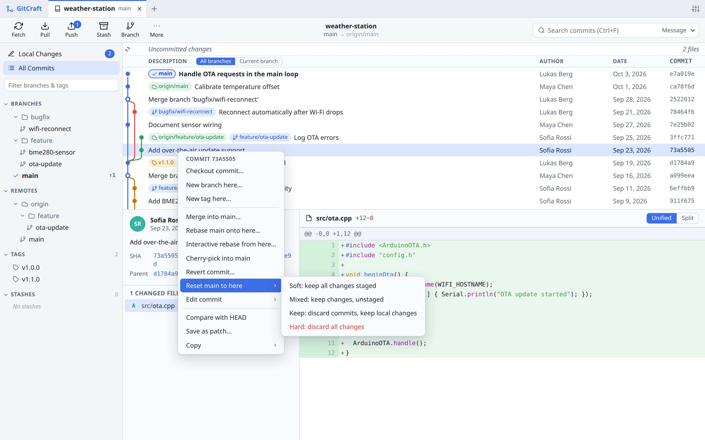
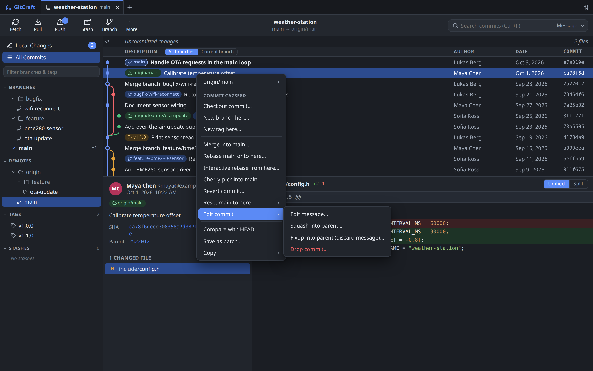

# GitCraft

An open-source, cross-platform graphical Git client.
It runs on Linux, macOS and Windows: a small Python ([Litestar](https://litestar.dev/)) server drives your
installed `git`, and the Angular UI runs in your browser on `127.0.0.1`.

| Light | Dark |
| --- | --- |
|  |  |

## Features

- **Commit graph**: virtual-scrolled history of all branches with lane graph, branch/tag/remote badges,
  commit details and per-file diffs (unified or side-by-side, syntax highlighted).
- **Local changes**: stage/unstage/discard files, **hunks or individual lines**; commit, amend,
  commit templates; multi-select with Ctrl/Shift.
- **Branches, tags, remotes**: sidebar with folder trees, ahead/behind counts, checkout (double-click),
  create, rename, delete, upstream tracking, push/delete remote branches and tags, add/edit/remove remotes.
- **Fetch / pull / push** with live progress (merge, rebase or fast-forward pulls; force-with-lease).
- **Merge, rebase, cherry-pick, revert, reset (soft/mixed/keep/hard), undo last commit** from context
  menus on commits, branch/tag badges and sidebar refs; banner with Continue/Skip/Abort while an
  operation is in progress.
- **Edit history** from the commit menu: edit message, squash/fixup into parent, drop commit.
- **Compare** any two commits (Ctrl/Cmd+click), filter history to the current branch, **reflog** to
  recover lost commits, fast-forward branches without checking them out.
- **Patches** (save commit as patch, apply / `git am`), **.gitignore** from the changes list, stash selected
  files, clean untracked files, checkout a file at a revision, prune remotes, update submodules.
- **Interactive rebase** editor: drag to reorder, pick/reword/edit/squash/fixup/drop, keyboard shortcuts.
- **Conflict resolver**: per-conflict ours/theirs/both choices, editable result, take whole file.
- **Stashes**: create (incl. untracked / staged only), browse, apply, pop, drop.
- **File history**, **blame**, **commit search** (message, author, SHA, content `-S`).
- Repository **tabs**, recent repositories, folder browser, clone, init.
- Live refresh through file watching, **light/dark** theme, keyboard shortcuts.

## Requirements

- `git` 2.30 or newer on `PATH`
- [uv](https://docs.astral.sh/uv/), the Python package and project manager. It installs a suitable
  Python (3.10+) by itself if none is present.
- Node.js 20+ (only to build the frontend)

### Installing uv

See the [uv installation guide](https://docs.astral.sh/uv/getting-started/installation/) for all options.
In short:

```bash
curl -LsSf https://astral.sh/uv/install.sh | sh                        # Linux and macOS
powershell -ExecutionPolicy ByPass -c "irm https://astral.sh/uv/install.ps1 | iex"   # Windows
brew install uv                                                        # Homebrew
```

## Install & run

```bash
# 1. Build the UI (output goes to backend/gitcraft/static)
cd frontend
npm ci
npm run build

# 2. Install the server (creates backend/.venv from uv.lock)
cd ../backend
uv sync

# 3. Start (opens your browser)
uv run gitcraft                  # or: uv run gitcraft path/to/repo
```

`uv run` keeps the environment in sync with `pyproject.toml` and `uv.lock` before it starts a command,
so there is no virtualenv to activate. Useful commands (see the
[uv project guide](https://docs.astral.sh/uv/guides/projects/)):

| Command (in `backend/`) | What it does |
| --- | --- |
| `uv sync` | Create or update `.venv` with the app and the `dev` group (pytest…) |
| `uv sync --no-dev` | Only the runtime dependencies |
| `uv run <cmd>` | Run a command inside the environment, e.g. `uv run pytest` |
| `uv add <pkg>` / `uv add --dev <pkg>` | Add a runtime / development dependency (updates `uv.lock`) |
| `uv lock --upgrade` | Upgrade all locked versions |

Options: `--port 7420`, `--host 127.0.0.1`, `--no-browser`. The command prints a URL containing a
session token; open that URL (it is opened automatically unless `--no-browser` is given).

Authentication for remotes uses your normal git setup: credential helpers (e.g. Git Credential Manager,
macOS keychain, libsecret) and the SSH agent. GitCraft never prompts for passwords itself.

## Desktop app (Electron)

GitCraft can also be packaged as a native desktop app for Linux, macOS and Windows. The Electron shell
in `desktop/` starts a frozen copy of the server (built with PyInstaller, so users need neither Python
nor Node) on a random local port with a fresh session token, and shows the UI in a native window with
a native menu, folder picker and "Show in file manager". The server exits together with the app.

```bash
cd desktop
npm ci
npm start [path/to/repo]   # development: uses backend/.venv (run `uv sync` first) and the built frontend
npm run dist               # builds UI + server bundle + installers into desktop/release/
```

`npm run dist` produces, for the platform it runs on:

| Platform | Output |
| --- | --- |
| Linux | `.AppImage`, `.deb` |
| macOS | `.dmg`, `.zip` |
| Windows | NSIS installer `.exe` |

`npm run dist` calls `uv sync --group bundle` and `uv run --group bundle pyinstaller`, so uv has to
be installed for packaging as well. Installers must be built on their own OS (PyInstaller cannot cross-compile); the GitHub Actions
workflow `.github/workflows/desktop.yml` tests and builds all three. The builds are unsigned; add
code-signing certificates (electron-builder `CSC_LINK` / `CSC_KEY_PASSWORD`, Apple notarization) for
public releases. `git` must be installed on the user's machine (the `.deb` depends on it).

## Development

```bash
cd backend && uv sync
cd ../frontend && npm ci
cd .. && scripts/dev.sh          # backend on :7420 with reload, UI on :4200
# open http://localhost:4200/?token=dev
```

On Windows run the two parts by hand:
`set GITCRAFT_TOKEN=dev && uv run uvicorn gitcraft.app:dev_app --factory --reload --port 7420`
in `backend/`, and `npx ng serve` in `frontend/`.

Tests:

```bash
cd backend && uv run pytest            # git operations against throwaway repositories
cd frontend && npx ng test --watch=false
```

## Architecture

```
browser (Angular 22, signals)  ──HTTP JSON + WebSocket──►  Litestar on 127.0.0.1
                                                             └─► git CLI (asyncio subprocess)
```

| Path | Purpose |
| --- | --- |
| `backend/gitcraft/git/runner.py` | Runs `git` without a shell or terminal; non-interactive editor; per-repo lock |
| `backend/gitcraft/git/parsers.py` | Parsers for log, status v2, refs, diffs, blame, conflict markers; partial patch builder |
| `backend/gitcraft/git/graph.py` | Lane layout for the commit graph |
| `backend/gitcraft/git/queries.py` / `ops.py` | Read-only queries / mutating operations |
| `backend/gitcraft/git/editor_helper.py` | `GIT_EDITOR` / `GIT_SEQUENCE_EDITOR` used for interactive rebase |
| `backend/gitcraft/routes/` | REST endpoints under `/api` |
| `backend/gitcraft/ws.py` | WebSocket: file-watch notifications and progress |
| `frontend/src/app/core/` | API client, per-repository state, git actions & menus |
| `frontend/src/app/*/` | UI: history, changes, diff, sidebar, rebase, conflicts, blame/file history |
| `backend/packaging/` | PyInstaller spec and entry point for the bundled server |
| `desktop/main.js` / `preload.js` | Electron main process (server sidecar, window, menu) and the `gitcraftDesktop` bridge |

Line staging works by rebuilding a patch with only the selected lines from the parsed diff and applying
it with `git apply --cached [--reverse] --recount`.

### Security

The server only listens on `127.0.0.1` and requires a random per-session token (header
`x-gitcraft-token` or `?token=`) for every API and WebSocket call, so other websites cannot drive your
git. Only repositories you opened (stored in your user config folder) can be accessed.

## Author

Jürgen Könnemann

## License

MIT © 2026 Jürgen Könnemann
