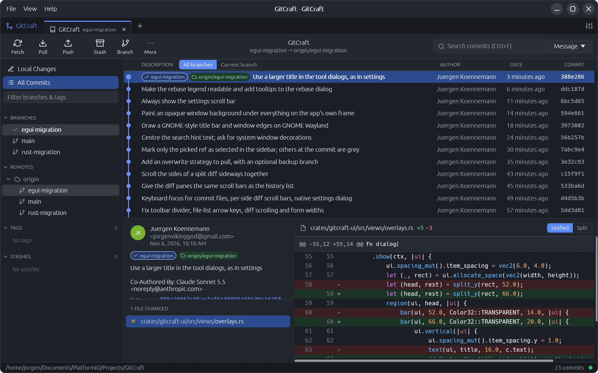
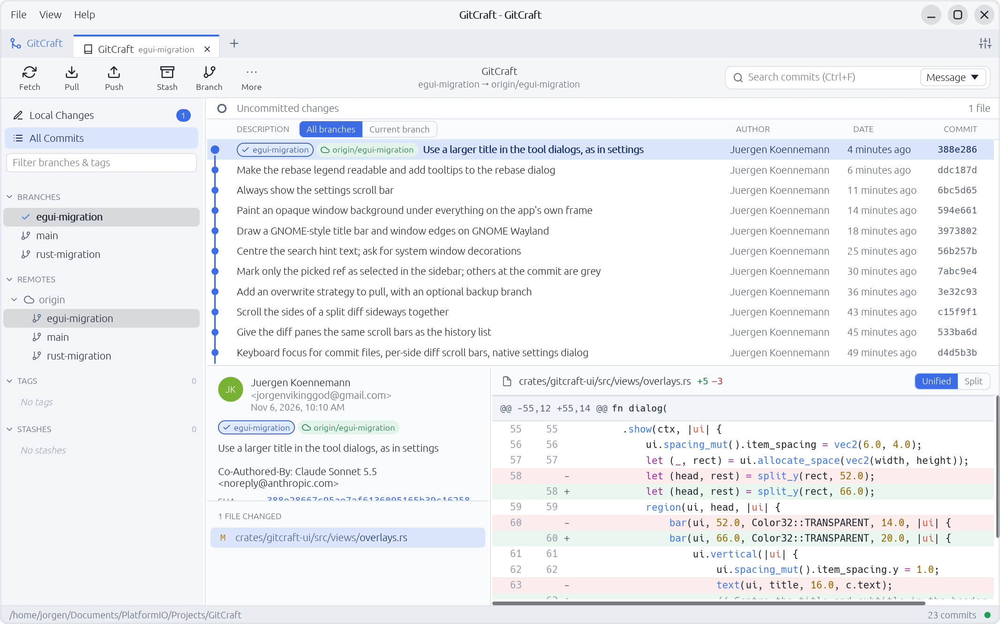

**GitCraft 0.2.0** is a graphical Git client written in Rust: one native program for Linux, macOS and Windows that drives your installed `git`.

Author: Jürgen Könnemann

| Dark | Light |
| --- | --- |
|  |  |

## What you get

**History**
- A virtual-scrolled commit graph of all branches, with branch, tag and remote badges.
- Commit details with per-file diffs, unified or side by side, with syntax highlighting. Long lines scroll sideways, and each side of a side-by-side diff has its own scroll bar.
- Search by message, author, SHA or content; compare any two commits; reflog, blame and file history.

**Working with changes**
- Stage, unstage and discard files, hunks or single lines. Commit, amend, commit templates.
- Stashes (including untracked or staged-only), patches, `.gitignore` from the changes list.
- Arrow keys move through the file list you last clicked.

**Branches and remotes**
- Branches, remotes, tags, stashes and submodules as collapsible trees in the sidebar. Only the branch or tag you pick is marked blue; other names at the same commit get a grey box.
- Fetch, pull and push with live progress.
- **New: pull with "Overwrite local branch with the remote branch"**, with an optional backup branch (`backup/<branch>-<short sha>`) and a confirmation first.

**Rewriting history**
- Merge, rebase (with optional autostash), cherry-pick, revert, reset and undo last commit from context menus. Edit a commit's message, squash or fixup it into its parent, or drop it, straight from the commit menu.
- An interactive rebase editor: drag to reorder, pick, reword, edit, squash, fixup and drop, with tooltips and keyboard shortcuts.
- A conflict resolver with per-conflict choices and an editable result.

**The window**
- Light and dark themes, zoom, repository tabs, live refresh when files change.
- On GNOME with Wayland, GitCraft draws a GNOME-style title bar and window edges, because the window toolkit would otherwise show a flat grey frame. Set `GITCRAFT_SYSTEM_FRAME=1` to use the toolkit's frame instead.

## Requirements

`git` 2.35 or newer on your `PATH`. GitCraft uses your normal git setup for authentication: credential helpers and the SSH agent. It never asks for passwords itself.

## Installers

| System | File |
| --- | --- |
| Windows | `.msi` installer |
| macOS, Apple silicon and Intel | `.dmg` disk image (one for each chip) |
| Linux | `.deb` package and a portable `.AppImage` |

The installers aren't code-signed yet. Windows SmartScreen and macOS Gatekeeper will warn on first launch; on macOS, right-click the app and choose Open.

## Known limits

- GitCraft has been developed and tested mostly on Linux (GNOME on Wayland). The macOS and Windows builds come from the release workflow.
- The interface uses egui's bundled font, with system fonts only as a fallback for scripts it doesn't cover; the font of your desktop isn't used.
- Settings, tabs and recent repositories are stored in the user config folder (`~/.config/gitcraft` on Linux, `~/Library/Application Support/gitcraft` on macOS, `%LOCALAPPDATA%\gitcraft` on Windows).

See the [README](https://github.com/Jorgen-VikingGod/GitCraft/blob/v0.2.0/README.md) for the full feature list, keyboard shortcuts and build instructions.
